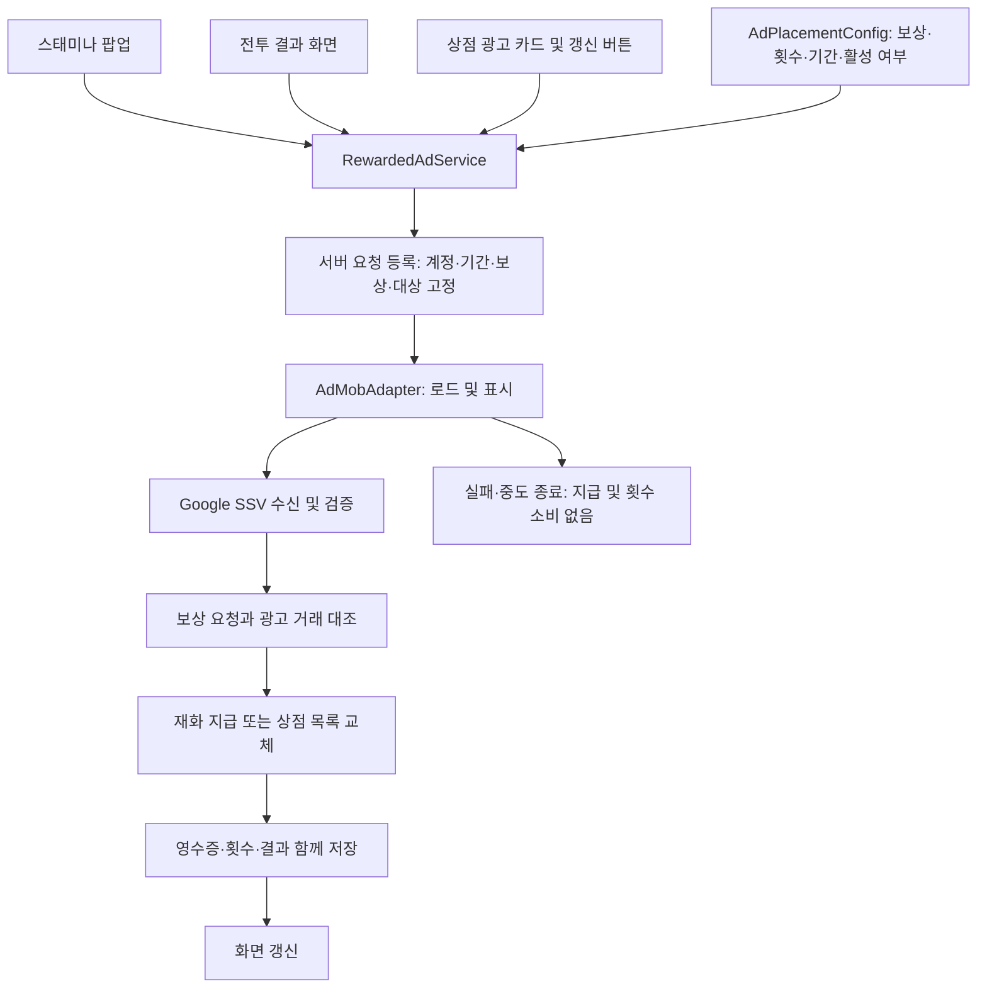
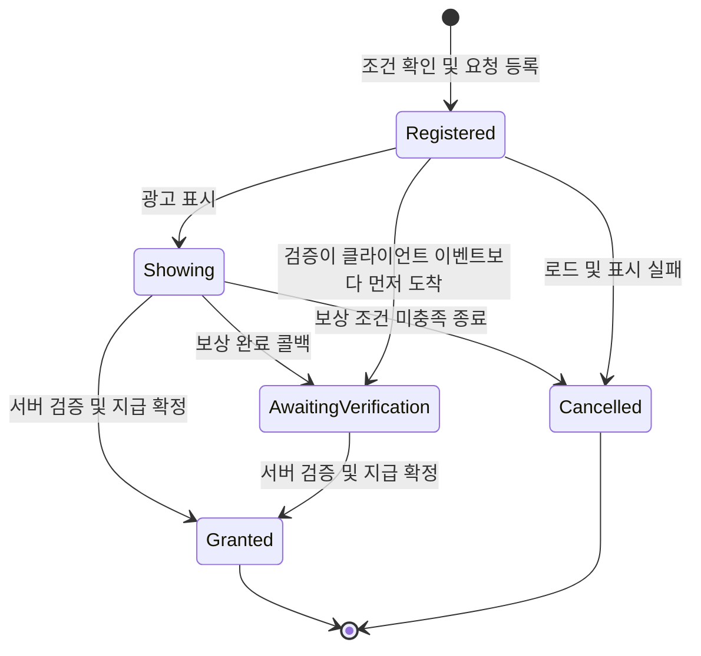

# AdMob 보상형 광고 구조 설계

작성일: 2026-11-14
상태: 연결 구조 설계와 격리 시뮬레이터. 운영 연결·밸런스 미확정.

## 설계 전제

- 사용자가 선택하는 보상형 광고를 사용한다. 전투 시작·종료 시 자동 광고는 넣지 않는다.
- 스태미나는 일 1회로 가정한다. 전투는 런당 1회, 상점 보상은 골드·강화석 합산 일 3회다. 일일/주간 갱신은 각각 일/주 1회를 가정한다. 보상량은 미확정이다.
- 광고를 보지 않아도 기본 보상과 기존 구매·플레이 흐름을 이용할 수 있다.
- 이번 범위는 연결 계약과 설계 문서다. 실제 SDK·서버·차트·게임 씬에는 연결하지 않는다.

## 1. 기본 광고 배치

| 배치 키 | 위치 | 권장 제한 | 보상 또는 효과 |
|---|---|---|---|
| StaminaRefill | 스태미나 팝업, 출격 부족 안내 | 일 1회 | 현재 출격 비용의 2배만큼 스태미나 충전 (수량 제안) |
| BattleRewardDouble | 전투 결과 화면 | 런당 1회 (별도 일 제한 없음) | 확정 전투 골드·강화석을 한 번 더 지급 |
| DailyReward | 상점 광고 보상 카드 | 골드·강화석 합산 일 3회 | 사용자가 둘 중 하나 선택 |
| DailyShopRefresh | 일일 상점 헤더 | 일 1회 | 무작위 판매 목록 재추첨 |
| WeeklyShopRefresh | 주간 상점 헤더 | 주 1회 | 무작위 판매 목록 재추첨 |

### 보상 규칙

- 스태미나: 광고 시작 전에 충전량과 보유 상한을 확인한다. 보상으로 자연 회복 상한을 넘는 것은 허용하되, 저장 자료형 한계는 넘지 않는다. 기존 다이아 충전과 별도 횟수를 사용한다.
- 전투 2배: 경험치·미션·이벤트·최초 달성 보상은 제외한다. 연구 보너스와 반올림까지 적용된 최종 골드·강화석 스냅샷을 복사한다. 추가 지급 시 연구 배율을 다시 적용하지 않는다.
- 일일 보상: 같은 종류를 3번 선택해도 된다. 골드·강화석 양쪽에 남은 공통 횟수를 표시한다. 선택한 보상은 광고 시작 시 고정한다.
- 일일 보상 수량: 일반 전투 1회 수준의 가치를 출발점으로 삼되, 기본 전투 보상과 강화 비용 확정 후 결정한다. 두 선택지의 가치를 비슷하게 맞춘다.
- 상점 갱신: 무작위 슬롯만 교체한다. 무료 고정 보상과 주간 한정 상품의 구매 제한은 초기화하지 않는다. 재추첨 결과가 이전과 일부 겹칠 수 있으며, 희귀 상품 보장은 제공하지 않는다.
- 광고 목록 갱신 후 무작위 상품은 새 목록 기준으로 재구매 가능하다. 구매 기록은 기간·목록 버전·상품 ID로 구분한다.

## 2. 전체 구조도

위 서버 검증 경로는 목표 구조다. SSV 수신 엔드포인트와 서버의 조건부 갱신·트랜잭션 지원 여부는 구현 전에 확인해야 한다.

| 구성 | 책임 |
|---|---|
| AdPlacementConfig | 배치별 보상, 제한 횟수, 초기화 주기, 활성 여부. 기존 차트 설정 방식에 맞춘다. |
| RewardedAdService | 조건 검사, 요청 수명 관리, 동시 실행 차단, 결과 재조회. 화면에서 지급하지 않는다. |
| AdMobAdapter | SDK 초기화·광고 로드·표시·콜백 연결. 게임 보상량을 결정하지 않는다. |
| 서버 광고 보상 처리 | 검증, 중복 방지, 계정 및 기간 확인, 효과와 횟수의 확정 |
| 기존 재화·상점 저장 경로 | 확정된 변경 저장. 광고를 이유로 별도 재화 저장소를 만들지 않는다. |

## 3. 요청 상태와 데이터

- 클라이언트 상태는 표시용이다. 앱 종료나 늦은 검증 콜백이 있어도 서버 요청과 영수증으로 복구한다.
- 닫힘 콜백만으로 지급하지 않는다. 보상 콜백이 먼저 왔다면 닫힘 이벤트로 취소하지 않는다.
- 미확정 요청은 새 광고보다 먼저 재조회한다. 명확한 미시청 종료와 검증 대기를 구분한다.

| 데이터 | 용도 |
|---|---|
| requestId | 광고 시도 식별. 재시도해도 같은 보상을 중복 확정하지 않음 |
| accountId / placementKey | 지급 대상 및 광고 종류 |
| periodKey | 시작 시점의 일일·주간 귀속 |
| rewardSnapshot | 시작 전 사용자에게 표시한 보상 종류·수량 |
| runId | 전투 2배의 대상 런. 다른 런과 혼용 금지 |
| stockRevision | 갱신 대상 상점 목록 버전 |
| transactionId | SSV 광고 거래 식별. 서버에서 중복 처리 방지 |
| status / result | 지급 대기·완료 상태와 확정 결과 |

### 확정 원칙

1. 광고 표시 전에 서버가 남은 횟수와 대상을 확인하고 요청을 등록한다.
2. 계정당 미확정 광고 요청 하나만 허용해 동시 기기에서도 제한 초과를 막는다.
3. 검증 성공 시 횟수 증가·효과 적용·영수증을 하나의 논리 거래로 확정한다.
4. 여러 저장 문서에 걸치면 기존 저장 방식의 원자성을 확인한다. 지원하지 않으면 단계별 영수증과 재처리로 중간 실패를 복구한다.
5. 통신 실패는 실패 확정으로 취급하지 않는다. `지급 확인 중` 표시 후 동일 요청을 조회한다.
6. 광고 실패·미시청은 횟수를 소비하지 않는다. 완료한 광고를 저장 실패 때문에 다시 시청시키지 않는다.
7. 요청 기간은 시작 시 고정한다. 초기화를 넘긴 검증은 이전 기간 요청으로 처리하고 새 기간 횟수는 소비하지 않는다.
8. 계정 전환 후 도착한 콜백은 원래 계정에 귀속한다.

## 4. 전투·상점의 별도 규칙

### 전투 2배

- 정상 종료한 전투만 대상이며 오류 종료·튜토리얼·임의 나가기는 제외하는 것을 초기안으로 한다.
- 기본 보상 정산과 저장을 먼저 완료한다. 추가 광고 보상은 별도 영수증으로 기록한다.
- 기본 보상: `battle:{runId}` / 광고 추가 보상: `battle-ad:{runId}`.
- 광고 대기 중 결과 화면을 닫아도 지급 요청은 유지한다. 서버 확인 후 재접속 시에도 수령 결과를 반영한다.
- 보상량이 0이면 버튼을 노출하지 않는다.

### 상점 목록 갱신

- 광고 시작 전에 현재 목록 버전과 갱신 대상을 고정한다.
- 새 목록은 요청별로 한 번 생성·보관한다. 저장 재시도로 재추첨하지 않는다.
- 표시 중인 상점의 구매와 갱신은 직렬화하고, 구매 확정 시 목록 버전을 다시 확인한다.
- 초기화를 넘겨 검증되면 새 기간 목록을 덮어쓰지 않는다. 요청에 귀속된 추가 갱신권을 보관하고, 해당 상점의 다음 이용 시 한 번 적용한다. 원래 기간 광고 사용은 완료 처리한다.
- 추가 갱신권은 자동 초기화·광고 갱신과 구분하고 중복 적용을 막는다. 이 경계 처리가 부담이면 광고 시작 가능 시간을 초기화 직전 일정 구간 제한하는 대안을 검토한다.

## 5. 현재 프로젝트 연결 지점

| 현재 파일 | 연결 방향 |
|---|---|
| Assets/WorkSpace/HSD/Scripts/Data/Stamina/StaminaConfig.cs | 현재 출격 비용 참조. 광고 충전 보상은 다이아 충전과 분리 |
| Assets/WorkSpace/USW/Scripts/OutGame/StaminaInsufficientPopup.cs | 광고 충전 진입 UI 후보 |
| Assets/WorkSpace/USW/Scripts/OutGame/PlayerDataController.cs | 기존 재화 저장·영수증 경로 연계. GrantBattleRewardAsync 재호출만으로 2배를 구현하지 않음 |
| Assets/WorkSpace/USW/Shop/AccountShopHost.cs | 상점 광고 카드·갱신 요청 UI 연계 |
| Assets/WorkSpace/HSD/Scripts/Shop/DailyShopManager.cs | 기간별 기존 목록·구매 흐름에 목록 버전과 광고 갱신 추가 |
| Assets/WorkSpace/USW/Shop/ShopStockSelection.cs | 기존 무작위 상품 추첨 재사용 검토 |
| Assets/WorkSpace/USW/Scripts/PeriodData/PeriodModels.cs | 기존 일일·주간 기간 키 재사용 |

기간 경계는 현재 코드와 동일하게 일일 KST 05시, 주간 월요일 KST 05시를 사용한다. 하네스 카드상 전투 기본 보상 연결은 대기 상태이므로 구현 착수 시 실제 연결 상태를 재확인한다.

## 6. 우리 게임에 추가할 만한 광고 요소

아래는 신규 제안이며 적용 결정이 아니다. 기존 다섯 배치의 이용률 확인 후 하나씩 도입한다.

| 우선순위 | 후보 | 우리 게임에서의 의미 | 초기 제한안 | 판단 |
|---|---|---|---|---|
| 1 | 토템 후보 재추첨 | 범위·배치·버프 조합에 맞는 선택 기회를 추가 | 런당 1회 | 게임 특성과 가장 잘 맞음. 실제 토템 선택창에서만 제공 |
| 2 | 일반 레벨업 카드 재추첨 | 드론·스킬 빌드가 어긋날 때 선택 기회 제공 | 토템과 합산 런당 1회 | 기존 재선택 기능·비용 규칙 확인 후 연결 |
| 3 | 일일 첫 출격 지원 꾸러미 | 스태미나와 소량 골드로 첫 플레이 유도 | 일 1회 | 스태미나 광고 또는 일일 보상 한 칸을 대체하는 방식 권장 |
| 4 | 기간 이벤트 광고 보상 | 이벤트 기간에만 전용 재화 지급 | 이벤트별 일 1회 | 전용 재화·사용처가 실제 도입될 때 검토 |
| 보류 | 부활·전투 시간 추가 | 시간이 체력인 무한 런을 연장 | 미정 | 최고 기록과 진행 보상에 직접 영향. 광고 영향 기록의 취급 결정 필요 |
| 보류 | 시작 능력치·식량 추가 | 초반 빌드 편의 제공 | 미정 | 기본 전투 밸런스가 광고 시청 전제로 변할 위험 |
| 비추천 | 패널티 제거·봉인 해제 | 무한 런 제약 무효화 | — | 핵심 선택과 누적 난이도를 약화 |

### 추가 요소 추천 결론

**기존 다섯 배치 + 선택 재추첨 공통권 한 종류**가 적절하다. 토템 재추첨과 일반 카드 재추첨 중 한 곳에서만 런당 한 번 사용하게 하면 광고 수를 늘리지 않고 빌드 선택에 가치를 줄 수 있다.

- 재추첨은 동일 추첨 규칙으로 후보를 다시 구성한다. 희귀도 상승·원하는 결과·이전 후보 완전 제외를 보장하지 않는다.
- 토템 수령·카드 선택이 확정된 뒤에는 되돌릴 수 없다.
- 선택지 수 감소 등 런 패널티를 유지한다. 광고 재추첨으로 패널티를 우회하지 않는다.
- 광고 중에는 해당 선택과 전투 시간을 정지하고, 복귀 시 같은 런·라운드·선택 요청인지 확인한다.
- 현재 이어하기가 없는 구조에서는 광고 도중 앱 종료 후 런 복구를 보장하기 어렵다. 인게임 광고는 이 복구 정책을 정한 후 도입한다.
- 장기적으로 광고 없이도 얻을 수 있는 재추첨 수단과의 비용 관계를 정한다. 새 기능을 위해 기존 재선택 경제를 임의로 바꾸지 않는다.

## 7. 구현 순서와 완료 기준

| 순서 | 범위 | 완료 기준 |
|---|---|---|
| 1 | 공통 광고 요청·검증·일일 보상·스태미나 | 제한 횟수 준수, 미시청 미차감, 중복 콜백·재접속에도 1회 지급 |
| 2 | 기본 전투 정산·광고 2배 | 최종 골드·강화석만 정확히 2배, 런당 1회, 연구 배율 재적용 없음 |
| 3 | 일일·주간 상점 갱신 | 재접속 목록 유지, 구매와 갱신 충돌 없음, 초기화 경계 보상 유실 없음 |
| 4 | 선택 재추첨 검토 | 기존 선택 경제 및 패널티 유지, 앱 중단 정책 확정, 공통 1회 제한 |

운영 집계는 배치별 노출·클릭·광고 로드 성공·시청 완료·지급 완료·지급 지연을 구분한다. 재화 공급량과 실제 광고 시청 횟수를 보고 보상·제한을 조정한다.

## 참고

- [Google Unity 보상형 광고](https://developers.google.com/admob/unity/rewarded)
- [Google Unity 서버 측 검증](https://developers.google.com/admob/unity/ssv)
- [Google 보상형 광고 정책](https://support.google.com/admob/answer/7313578)

## 8. 구현 경계와 후속 연결 계약

브랜치 `feat/today-unmerged-20261114`에는 연결 계약과 설계 문서만 남긴다. 독립 테스트 씬, 모의 어댑터·지급 원장, 테스트 UI와 검사 코드는 사용자 요청으로 제외했다.

| 파일 | 책임 |
|---|---|
| RewardedAdContracts.cs | 화면 → 서비스 → 광고 어댑터/지급 게이트웨이 계약. 서비스는 재화에 직접 접근하지 않음 |

광고 SDK 어댑터, 지급 게이트웨이, 서버 저장·검증·상점 갱신 처리는 아직 연결하지 않았다.

### 운영 연결 시 교체할 경계

1. `IRewardedAdAdapter.ShowAsync`: 동의/SDK 초기화 후 로드·표시·폐기한다. 보상/닫힘/표시 실패를 구분하고 한 시도는 한 번 완료한다. 배치별 광고 단위 ID를 설정하고 SSV custom_data에 서버 요청 ID를 전달한다. 콜백은 Unity 메인 스레드로 전달한다. 개발에는 공식 테스트 광고 ID를 사용한다.
2. `IRewardedAdGateway.RegisterAsync`: 인증된 서버 계정에서 허용 배치·횟수·전투 정산·상점 버전을 확인하고 보상과 기간을 고정한다. 클라이언트 수량을 신뢰하지 않는다. 계정 전체의 요청 예약은 원자적으로 처리한다.
3. `ObserveAsync`: 클라이언트 관찰만 기록한다. 네트워크 오류는 미확정으로 남기고 요청 ID를 보관한다. 선행 SSV 지급을 닫힘 이벤트로 취소하지 않는다. 취소 후 늦은 유효 SSV의 처리 정책은 서버 구현에서 확정해야 한다.
4. SSV 수신은 클라이언트 인터페이스에 노출하지 않는다. 서버가 서명·광고 단위·사용자·요청·transaction_id를 검증하고 재화/횟수/영수증을 함께 확정한다.
5. `FindAsync`: 재진입·계정 전환 후 원래 인증 계정의 요청을 복구한다. 타임아웃 후 재시청을 요구하지 않는다. 실서비스에는 등록 재시도용 멱등 키와 계정별 미확정 요청 목록 조회 API도 필요하다.
6. 전투 기본 정산 저장 성공 후 최종 골드·강화석과 runId를 등록한다. `GrantBattleRewardAsync`를 그대로 다시 호출해 연구 배율을 재적용하면 안 된다. 현재 기본 전투 보상 호출 연결은 대기 상태다.
7. `AccountShopHost`에 일일 공통3회 카드와 일/주 갱신 버튼을 연결한다. `DailyShopManager`에는 기간·revision·구매 영수증·한 번 생성한 목록·갱신권 소비를 기존 저장 체계에 추가한다. 기존 구매 경로에는 revision 검증이 없어 즉시 운영 연결할 수 없다.

### 미확정 및 미검증

스태미나1회의 초기화 주기, 실제 수량, 정상 종료 전투 범위, 상품별 기간 구매 제한, SSV 서버 수신 환경과 조건부 트랜잭션 지원을 확정해야 한다. 실제 광고·Android·SSV 서명·동시 기기·실서버 재접속은 검증하지 않았다.
